<div align="center">
  
  <h1>迹语 · 社区版</h1>
  <p>把笔记、任务和项目，整理在自己的电脑里。</p>
  <p>PC 本地工作台 · 无需账号 · 核心功能可离线 · 可备份与迁移</p>
</div>

> 社区自研代码采用 Apache-2.0。本源码候选已完成本地独立构建和公开范围核对，尚未发布到 GitHub；原生安装包的正式分发验收单独进行。

## 功能预览

本节截图来自社区版 PC Web 共用界面，使用独立空间和合成样例数据；不包含真实账号、私人资料或高级版页面，不代替原生安装包的实机验收。

### 首页：聚合记录与行动

快速记录想法，查看待办、最近笔记、专注统计与本地历法。

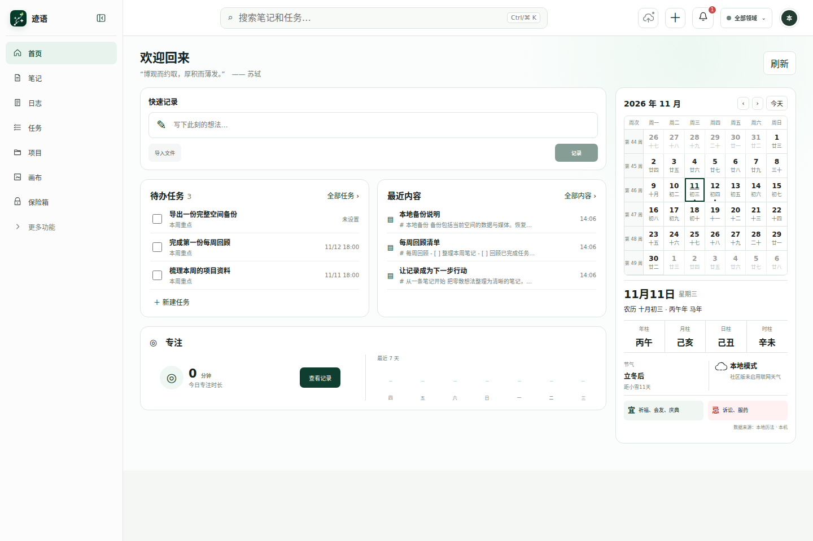

### 笔记：从记录到整理

Markdown 编辑、分屏和预览，配合目录、标签、大纲、收藏及归档。笔记大纲支持标题筛选；全文查找可查看匹配片段并跳转正文。

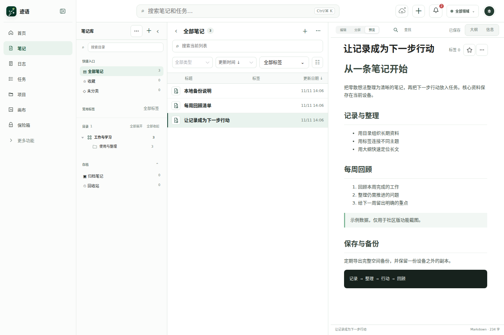

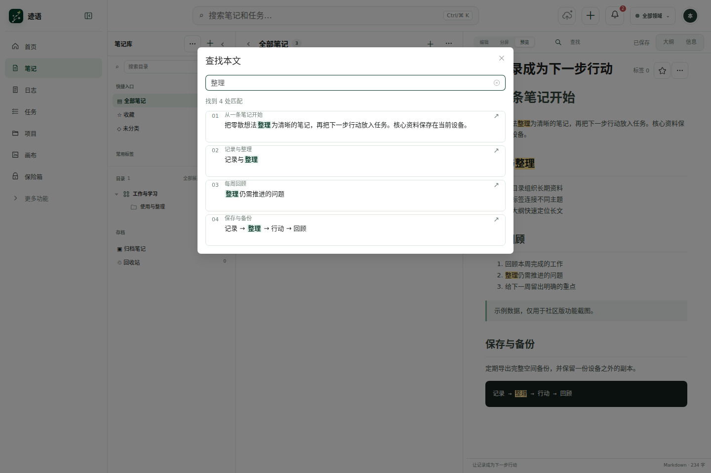

### 任务：让下一步行动清晰可见

支持清单、项目关联、子任务、日期与优先级，以及基础重复任务；列表、看板和日历提供不同查看方式。

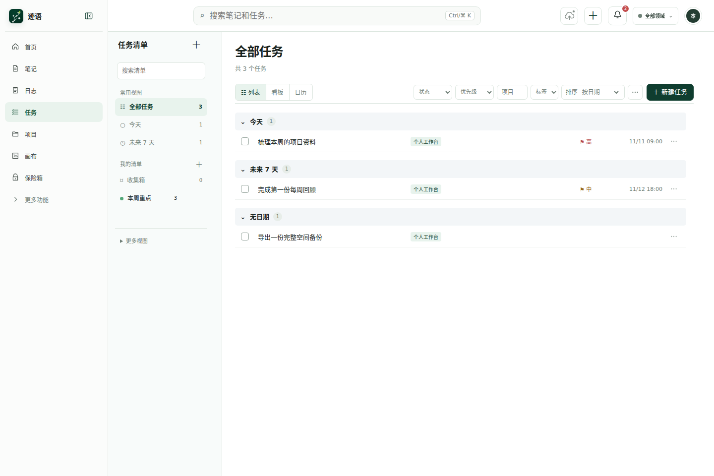

### 项目：把目标、资料与行动放在一起

按领域组织项目，查看项目状态，并在项目内管理任务与关联笔记。下面以合成的“个人工作台”等项目展示切换列表和项目任务。

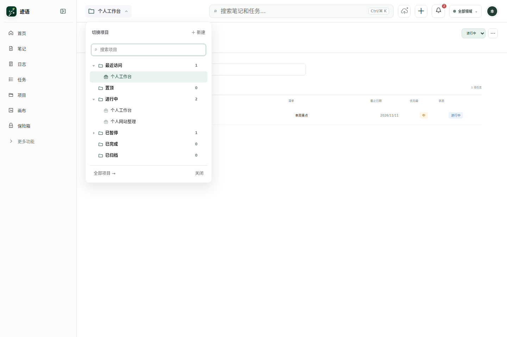

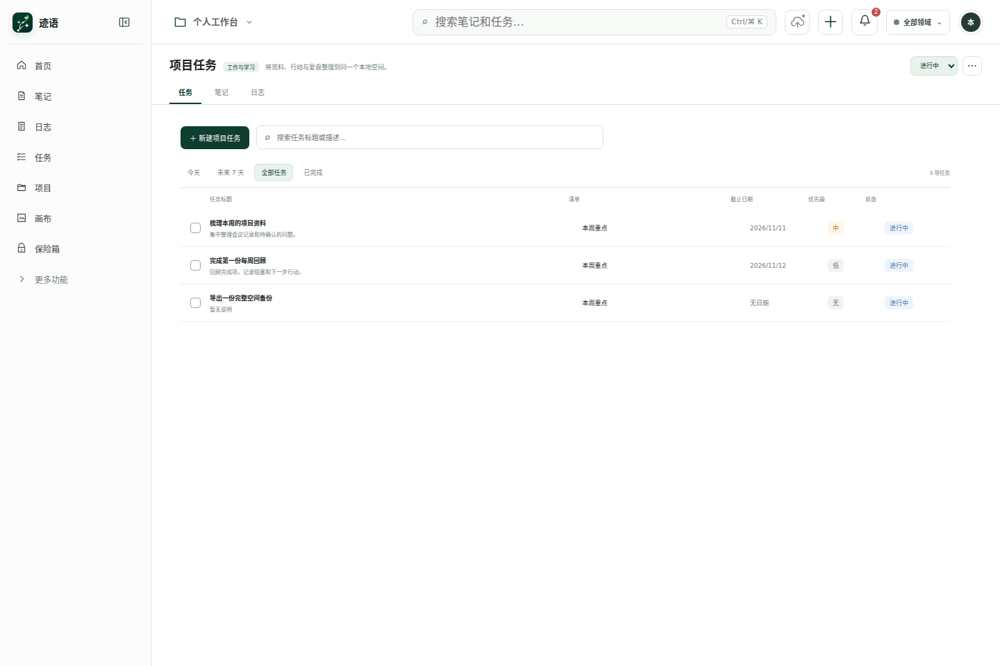

### 画布：用白板、流程图和思维导图梳理想法

白板提供自由绘制与头脑风暴等预设；Mermaid 流程图支持文本编辑和图形预览；思维导图用于组织主题与层级。

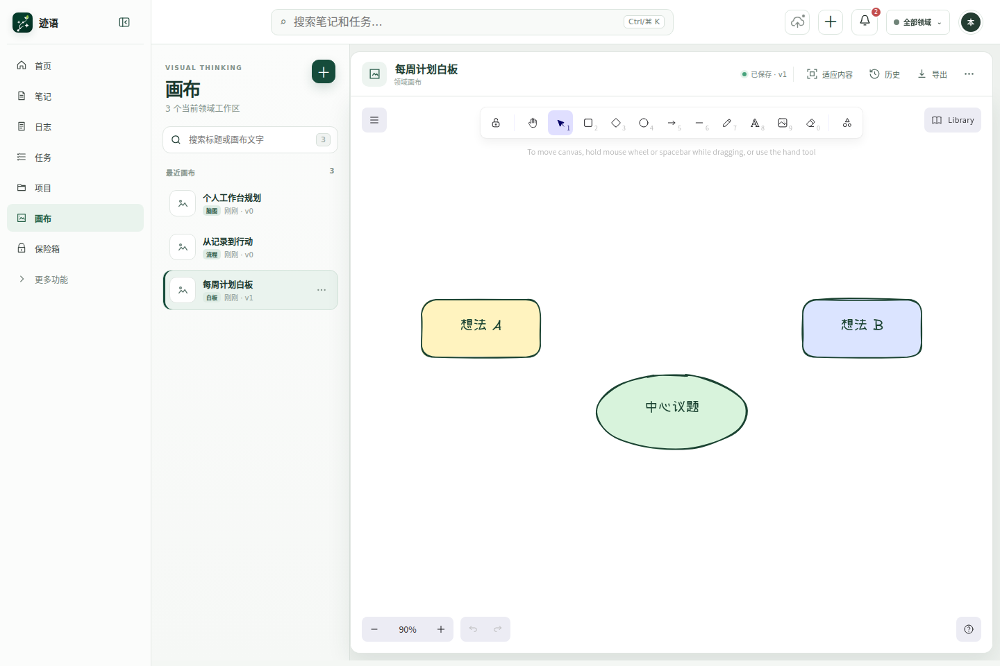

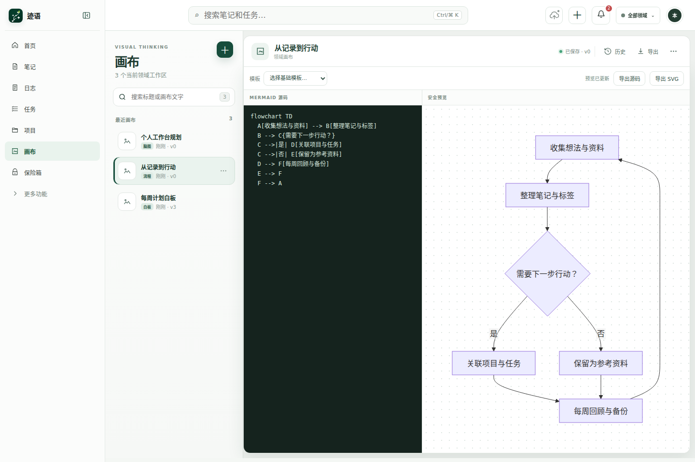

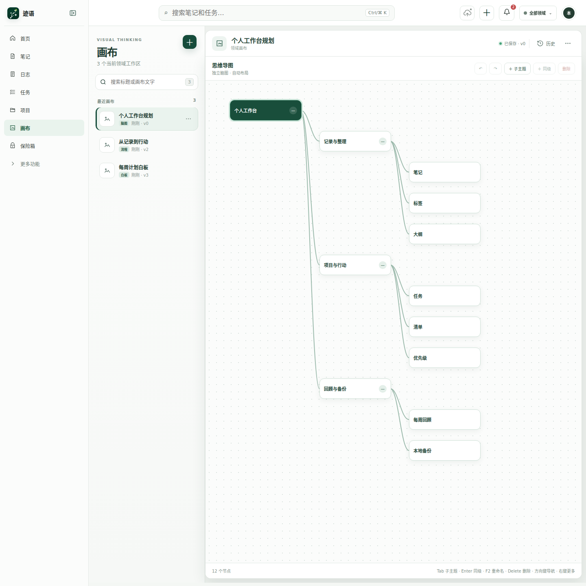

社区版还提供离线基础图表编辑，范围为通用图形、连线和基础流程图，不包含行业图库与自动避障布线。

### 专注：为当前行动留出一段时间

使用专注计时器安排工作与休息，并查看专注记录。

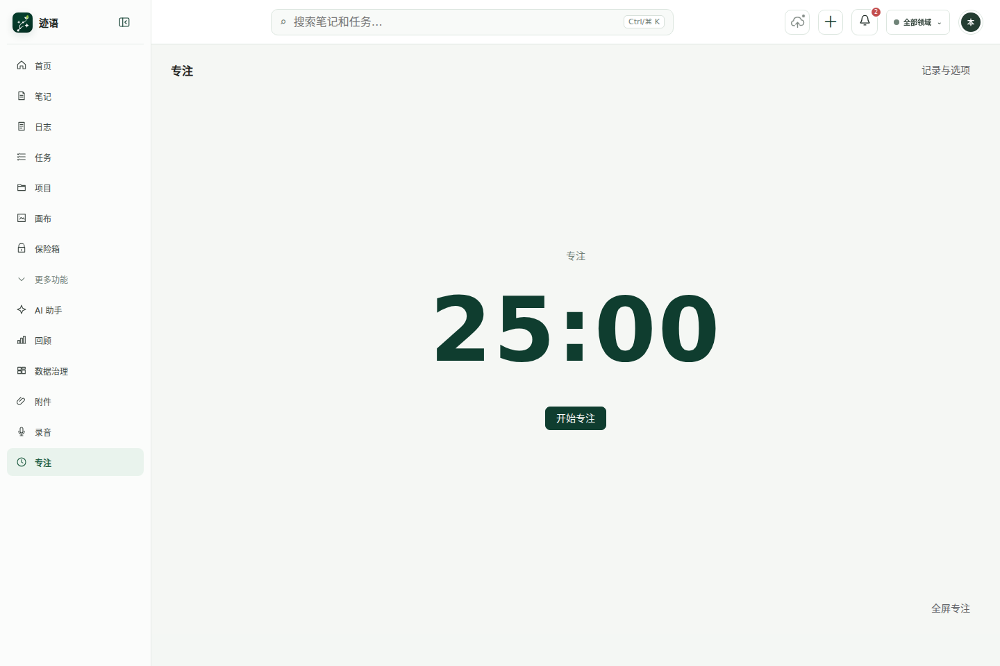

### 设置：调整工作台，管理本地备份

在设置中调整外观与编辑偏好，管理导入导出及完整空间备份。截图展示外观和备份恢复入口；恢复会创建新空间，原空间保留。

社区版设置不提供服务器账号登录或云端同步配置；AI 服务保留个人 API 与本地模型配置。

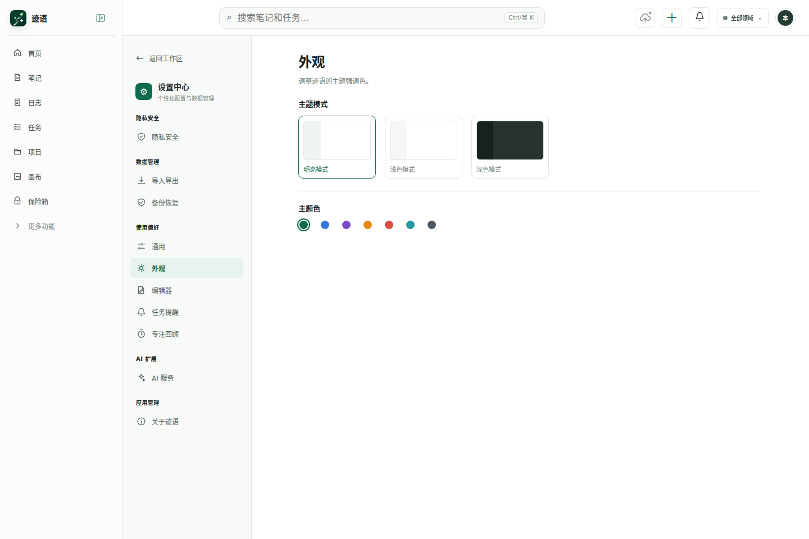

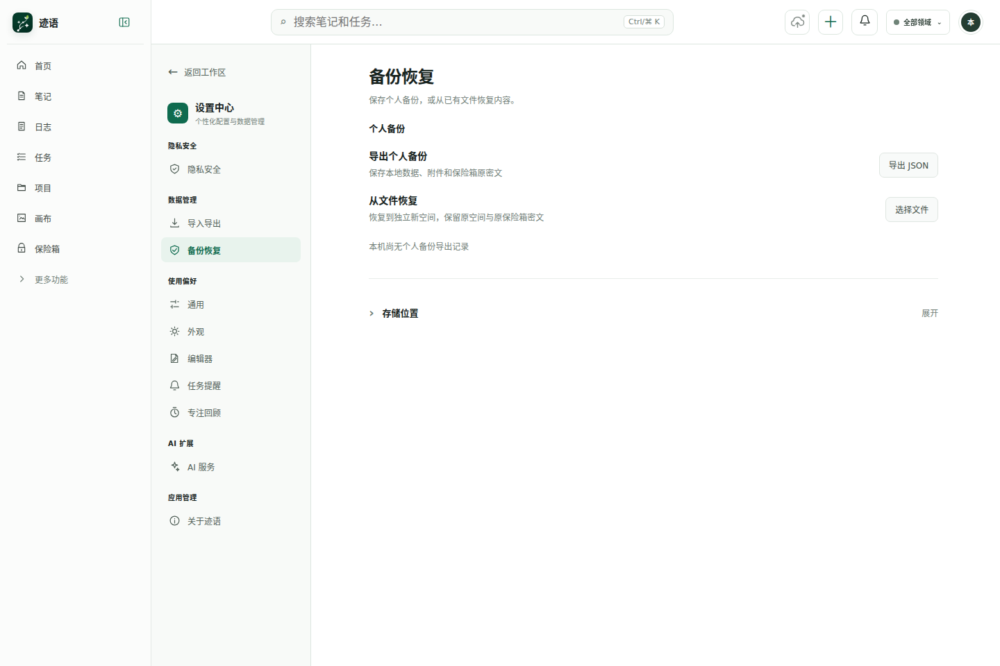

## 社区版与高级版

社区版面向 PC 单机使用；高级版增加移动端、知识体系和多端协作所需的账号与同步能力。复用基础组件，不代表每个版本开放全部功能。

| 能力 | 社区版 | 高级版 |
| --- | --- | --- |
| 客户端 | PC 桌面及 PC Web | PC、移动端及联网访问方式 |
| 账号与服务器 | 基础功能无需账号或后端 | 提供配套账号与服务端能力 |
| 笔记、目录、标签、搜索、大纲 | 本地使用 | 基础能力及跨端接续 |
| 任务、项目、日历、专注 | 本地使用 | 基础能力及跨端接续 |
| 重复任务 | 每日、每周、每月等基础规则 | 额外提供复杂规则与跨端调度 |
| 白板、思维导图、Mermaid 画布 | PC 本地使用 | PC 端保留基础能力 |
| 离线图表 | 通用图形、连线、基础流程图；无行业图库与自动避障布线 | 保留完整集成能力 |
| 本地加密保险箱 | 提供 | 提供，并有账号关联能力；移动端功能以对应版本为准 |
| 完整空间备份、恢复与版本迁移 | 提供；恢复创建新空间 | 提供，并有跨设备恢复能力 |
| 知识库及目录导入、知识图谱 | 不提供 | 提供 |
| 知识卡片与学习复习 | 不提供 | 提供 |
| 多端同步、冲突处理、云端媒体同步 | 不提供 | 提供 |
| AI 扩展 | 可自行配置本机或自有模型接口；不能读写知识库 | 叠加账号服务及高级资料处理能力 |

社区版的普通笔记搜索和标题大纲属于基础功能，不属于高级版知识库。普通“回顾”记录也不同于知识卡片的学习复习。

高级版各平台的页面和功能范围并非完全相同。本表说明版本边界，不承诺每个平台都包含全部 PC 编辑器。

## 进一步了解高级版

社区版聚焦电脑上的本地记录与行动，高级版面向跨设备接续和长期知识积累：

- **知识体系**：主题目录、知识正文、大纲阅读、目录导入与知识图谱，把零散资料组织成可持续完善的知识库。
- **知识卡片与复习**：从知识中提炼问题，管理卡片、查看答案并记录掌握程度，让阅读转化为反复回忆与理解。
- **多端接续**：PC 与移动端配合账号和同步服务，支持离线编辑后继续同步，以及冲突检查和处理。
- **进阶规则与服务**：复杂重复任务、跨端调度及账号模型服务，具体能力以对应客户端版本为准。

以下为高级版真实知识组件的演示截图，使用隔离的合成数据和模拟服务；展示界面与操作，不代表这些功能包含在社区源码中，也不作为真实服务同步验收。

知识库示例按“个人知识体系 / 知识整理”和“工程实践 / 同步与恢复”等主题展开；卡片示例使用独立的多级卡片目录，将问题分别归入学习方法与工程实践。

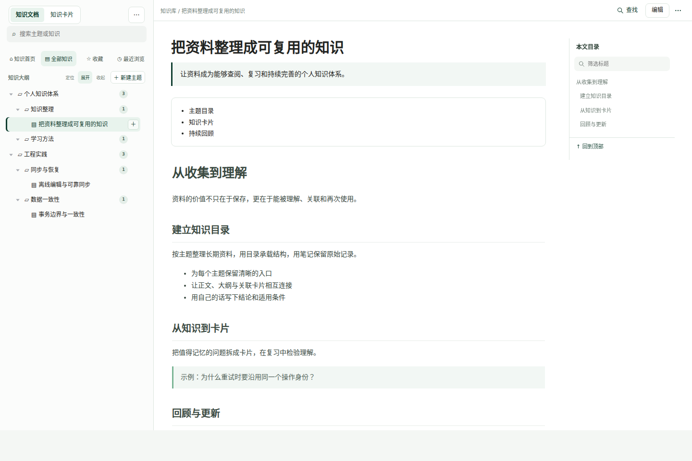

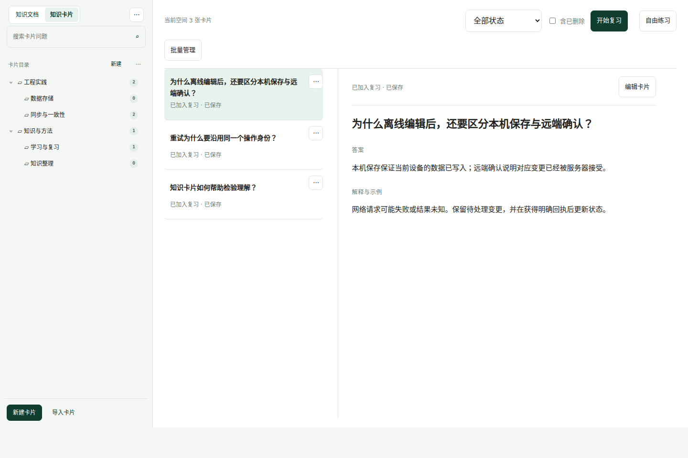

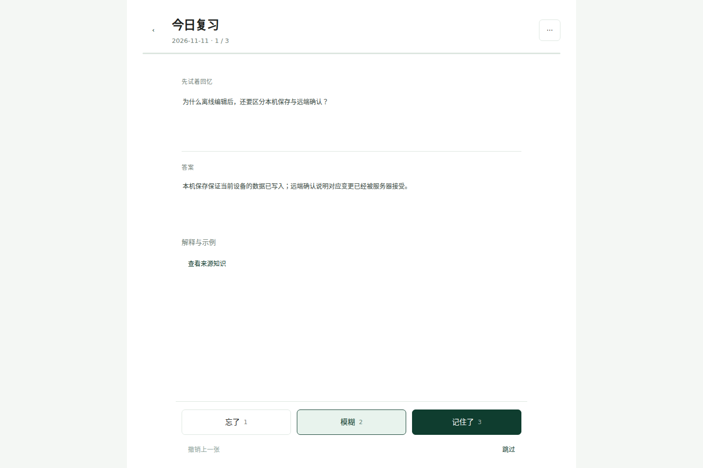

### 高级版移动端：随手记录、阅读与复习

高级版提供配套移动端，便于在手机上查看和编辑笔记、按目录阅读知识、翻卡复习，并通过账号同步服务与 PC 接续。移动端侧重随手记录与日常学习，PC 侧重长文编辑、知识整理和复杂画布；各端功能按对应版本提供。

下面展示移动端笔记列表、知识目录、卡片首页和复习反馈。截图来自真实移动页面在 390 × 844 视口中的隔离合成数据演示，不是把 PC 页面缩小，也不代表本轮进行了 Android/iOS 原生安装或真实同步验收。移动端属于高级版，其源码与构建入口不包含在本社区工程中。

| 随手查看笔记 | 按目录浏览知识 |
| --- | --- |
| 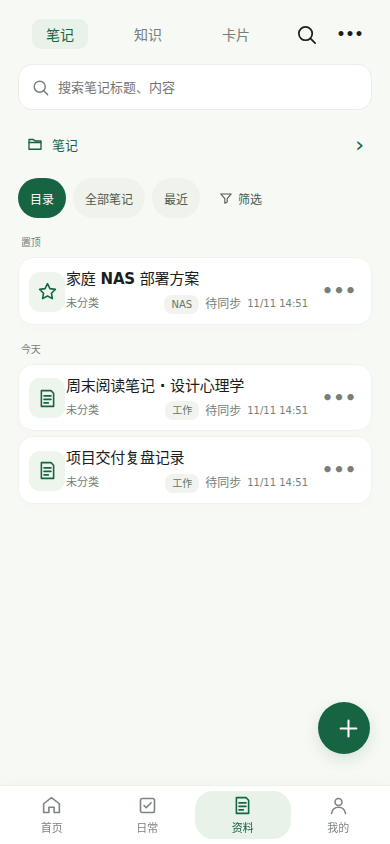 |  |

| 查看待复习卡片 | 回忆、核对与反馈 |
| --- | --- |
|  |  |

### 自研跨端同步引擎

高级版的同步围绕“先在本机工作，再明确确认远端结果”构建。自研的同步协调、持久队列与恢复机制配合正文 CRDT 技术，处理断网、重试、并发修改和跨设备接续：

- **离线优先**：先保存到本机，待处理的变更持久记录，网络恢复后继续推进。
- **幂等重试**：用稳定操作身份识别同一变更；请求结果未知时沿用原请求重试，避免把重复发送当成新的操作。
- **正文与元数据协同**：正文基于 Yjs/CRDT 合并，实体版本、引用和删除状态按契约校验；不能自动处理的冲突保留供用户选择。
- **确认与恢复有依据**：区分本机保存、远端接受和最终确认；账号或同步世代变化时隔离旧会话结果，避免把旧请求直接套用到新空间。
- **共同核心、多端适配**：PC Tauri、Android 和 C++ 宿主接入共享 Rust 同步机制，分别适配本机存储与系统能力。

自研部分是围绕资料一致性的协调和恢复实现；Yjs 等第三方技术继续遵循各自许可。同步引擎及配套服务属于高级版私有实现，不随本社区仓库分发。不同宿主支持的数据类型和自动同步范围分别验证；C++ 当前主要验证笔记/目录等受支持数据的主动同步，不能理解为所有业务都已跨端对齐。

### C++ 原生版：面向小体积与高性能

除 Vue/Tauri 客户端外，迹语还有 **C++20 + wxWidgets + SQLite** 原生桌面实现，配合共享 Rust 同步组件。界面使用原生控件，Markdown 预览使用原生 HTML 控件，无需 WebView2，也不捆绑 Chromium 浏览器运行时，着重控制运行时体积、内存占用和大文档操作成本。

已有 Windows 开发验证包的有限压力测试记录如下：

| 测量项目 | 实测记录 |
| --- | --- |
| 约 5 MiB Markdown 首次选中至标题读取 | 约 831 ms |
| 长短文交替切换 100 次 | P95 约 524 ms |
| 该轮切换后静置 15 秒的进程私有内存 | 约 53.7 MiB |

数据来自 2026-10-27 的 0.8.20 开发包，环境为 i5-13600K、约 31.8 GiB 内存、Windows 11；打开/切换计时包含自动化调度和标题读取，不等于完整页面绘制或物理键盘输入延迟。测试口径与包摘要见[原生版性能记录](docs/native-desktop-baseline.json)。这是历史单机样本，实际体验随设备、资料和版本变化。

C++ 原生版仍在持续完善，功能覆盖与 Tauri 版分别验证；其源码与安装包不包含在本社区工程中。安装包和免安装包的实际大小以对应版本交付清单为准。

## 快速开始

需要 Node.js 22。以下命令在独立社区源码目录执行，无需完整私有仓库、私有依赖仓库凭据或产品账号。

```bash
npm ci
npm test
npm run dev
```

使用终端给出的地址打开 `/community.html`。开发服务默认绑定本机地址；不要把开发服务直接当作公网生产站点。

生成生产 Web：

```bash
npm run build
npm run preview --workspace note-flow-community-web
```

Web 产物位于 `apps/desktop/dist-community/`，部署整个目录，入口为 `community.html`。使用 HTTPS 或 localhost；浏览器数据与网站来源绑定，更换域名、端口或清除网站数据前请先备份。

## 桌面构建

需要 PowerShell 7、Rust 及对应平台工具链。Linux 系统依赖、运行环境和已验证范围见 [支持与安装](docs/support.md)。

```powershell
# 只构建 Web 交付文件
pwsh -NoProfile -File scripts/build-pc.ps1 -WebOnly

# Linux：同时生成 DEB 安装包与 AppImage 免安装包
pwsh -NoProfile -File scripts/build-pc.ps1 -Bundles all

# Windows：NSIS 安装器与含应用载荷、可再分发 CRT 的绿色包
pwsh -NoProfile -File scripts/build-pc.ps1 -Bundles nsis
```

Windows 绿色包制作另需 7-Zip、Visual Studio 可再分发 CRT；运行时需 Windows 10/11 x64 和 WebView2。绿色包免安装应用本身，但数据仍在正常的用户目录，不能用它隔离已有空间。macOS 原生双格式交付尚未验证，暂不宣称已支持。

规范交付目录为 `artifacts/pc/<version>/community/`，包含产物和记录大小、SHA-256 的 `manifest.json`。Web 资源 ZIP 不等同于免安装桌面应用。当前 README 截图和 Web 构建通过，不代表已提供与本次源码对应的正式原生安装包。

社区版不提供 Android 或 iOS 构建。

## 数据与隐私

- 社区版的笔记、任务和附件保存在本机空间，不连接官方同步服务。
- 可选 AI、模型接口和外链内容可能访问网络；启用前请核对实际发送内容与服务提供方。
- 定期导出完整空间备份，另存一份到设备之外。关闭页面前等待保存完成；卸载或清除存储前先备份。
- 恢复创建新空间，原空间保留；保险箱以密文保存，主密码不写入备份。
- 旧知识实体和旧社区卡片库可作为历史档案保全。保留数据不重新开放知识功能，也不自动重放旧同步队列。
- 官方版与社区版使用独立空间。版本切换须使用专用切换文件并预览确认，普通备份不等同于同步或版本切换。

## 工程结构

```text
apps/desktop/               PC 页面与社区 Web
apps/desktop/src-tauri/     公共桌面宿主
packages/core/              基础契约与本地能力
packages/native-local-core/ 本地原生能力
scripts/                    社区构建与验证入口
docs/screenshots/           本 README 的实际功能截图
```

独立社区目录不包含服务端、私有同步引擎、移动应用或高级知识业务实现。为保留历史数据与版本迁移，部分交换格式和类型定义中仍会出现知识或卡片字段；这些不是可执行的高级功能入口。

## 贡献与问题反馈

参阅 [贡献说明](CONTRIBUTING.md)、[安全问题](SECURITY.md) 和 [支持范围](docs/support.md)。反馈问题时请附版本、操作系统和复现步骤；不要提交个人备份、保险箱内容、API 密钥或真实账号数据。

## 许可证与公开状态

社区自研代码采用 [Apache-2.0](LICENSE)。归属说明见 [NOTICE](NOTICE)，第三方组件及未完成的发布核验见 [第三方清单](THIRD_PARTY_NOTICES.md)。第三方代码、字体与资源继续适用原有许可。

社区源码公开与原生安装包发行分别验收。本候选已移除 libavoid 自动避障布线和带用途限制的行业图库，保留基础图表编辑。实际独立 Web 的184组模块均有许可材料；安装锁图中另4组未分发实现的依赖仍如实保留原文缺项，不能将这些引用等同于已打包代码，见 [分发核对](docs/third-party/source-distribution-review.json)。

正式原生安装包仍需核对实际平台共享库及分发归属。此源码不包含高级版或私有代码；请使用新的社区仓库建立历史，不上传完整开发主仓库或其 `.git`。
